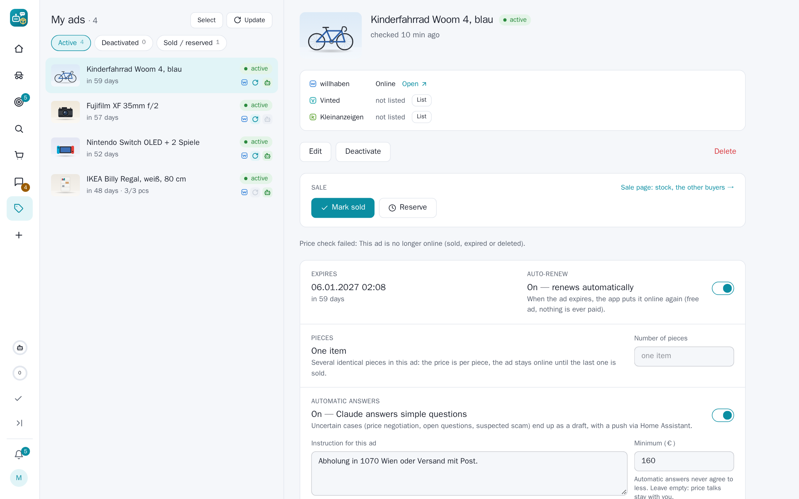
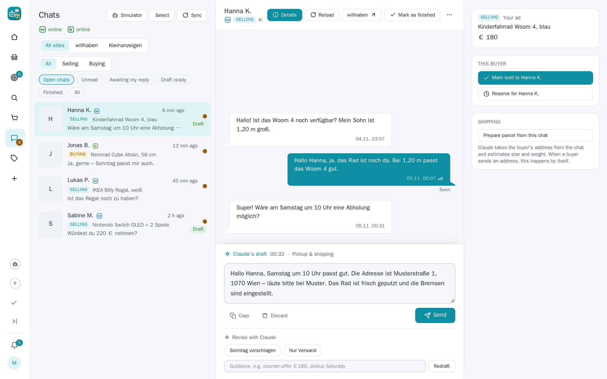

# Changelog

What changed in each release of SecondHandler, newest first. The pictures are in `docs/releases/v<version>/`;
every GitHub release takes its text from its section here.

## [SecondHandler 0.5.6](https://github.com/lumascet/SecondHandler/releases/tag/v0.5.6)

A release about selling on Kleinanzeigen as well and about fixing what an app-wide bug hunt found: an own willhaben ad
goes onto kleinanzeigen.de with one click or along with its publish, a pasted ad link lets you write to the seller,
Vinted's automatic login sticks, and close to thirty bugs across chats, buying, selling, search agents and Telegram are
gone.

### Own ads on Kleinanzeigen

- **A willhaben ad also on Kleinanzeigen.** My ads → the Kleinanzeigen line → **List**: title, text, photos and
  condition go through Kleinanzeigen's own ad form in the app's browser. The account must be logged in there
  (Settings → Platforms → Kleinanzeigen). Claude checks the category the site suggests and picks one from the site's
  own list when it does not fit; shipping is offered when the willhaben ad offers it.
- **Along with the publish.** The draft's publish card and the batch bar have *Also post on Kleinanzeigen* (off unless
  you switch the default on in Settings). A new ad is posted there once willhaben's review has it online.
- **A price of its own.** The comparable ads on Kleinanzeigen give a price with a note and the cost of shipping from
  Austria; the field can be changed and *Recalculate* reads the ads again. A price you did not type yourself never
  goes below the ad's minimum or 70 % of the willhaben price – then willhaben's price is posted.
- **The copy follows the ad.** Sold, reserved, expired, deleted or deactivated on willhaben reserves it on
  Kleinanzeigen; for sale again, it is activated again. Nothing is deleted there by itself: *Delete on Kleinanzeigen*
  does that, with a grace period. A renewed ad takes its copy along.
- **Never twice.** Anything unclear after the final click marks the ad *Check on Kleinanzeigen* instead of posting it
  again. This release has not posted on the live site yet: the first posting is the test, and the ad says where it
  got stuck.

### A shorter way to an online ad

- A written draft is prepared for willhaben by itself, so the publish card is ready when Claude is done.
- *Publish as soon as Claude is done* (off by default) puts the draft online by itself unless something needs you.
- The draft page and the batch bar have one clear order of buttons; the Telegram Mini App follows.

### Buying and chatting

- **A pasted ad link lets you write to the seller.** The price check of a pasted link has *Message the seller* (with
  the standard questions and *Claude writes*, e.g. an offer) or *Go to chat* when there is one.
- **Telegram's purchase button opens the buy dialog** with the dashboard's choices (way to buy, wish price, maximum,
  time, questions) when the web address is https; otherwise one tap starts with the defaults.
- **Vinted's automatic login sticks.** The login worked, but the check right after it handed the app's older session to
  the browser and undid it; the newer login now wins. A login that was sent but not seen is retried after 15 minutes.
- **An ad no longer online shows the copy the app kept** (text, photos, price, seller) with a note, not just "no
  longer online".
- A Kleinanzeigen buyer's first message is pushed; chats with more news than one sync reads are read again; removed or
  hidden Vinted and Kleinanzeigen chats come back when the other person writes; deleting a Kleinanzeigen chat no
  longer goes to willhaben; automatic answers work for Kleinanzeigen chats about own ads.

### Search agents and price checks

- **Screening without timeouts**: at most two Claude calls run at once over all agents, and a call that times out
  leaves its hits pending for the follow-up check instead of letting them through unjudged.
- The price-drop badge stays on Vinted, Kleinanzeigen, eBay and Shpock hits; a drop on a hit cleared by age brings it
  back and is reported; the push slots go to the drops that push.
- The price check's *Ask Claude*, *Compare again* and category keep the ad's site; *Recently checked* opens other
  sites' ads again.
- "Check now" and the follow-up check have a time limit; a Kleinanzeigen "VB" ad never comes back among the hits; a hit
  whose ad page says gone or sold is not pushed.

### Fixes

- An ad deactivated on willhaben is not for sale on Vinted and Kleinanzeigen either.
- A paid order never turns "failed"; an old cancelled order no longer blocks a manual Buy; auto-buy uses willhaben's own
  fee for the ad; a shipping label counts as paid only once the pay click went through.
- Telegram buttons open the ad or order they are about; the bot's ⭐ Keep says when the hit is gone; `/drafts` answers
  with its push kind switched off; "<site> needs you" is pushed once, not every hour.
- Settings → Claude: the token limit keeps "none" (0) and values over 50 M.

### Upgrading

- New database columns are added by themselves.
- Posting on Kleinanzeigen needs its account logged in in the app's browser and the platform switched on; the price
  analysis uses the Kleinanzeigen app credentials, as the search agents do.

## [SecondHandler 0.5.5](https://github.com/lumascet/SecondHandler/releases/tag/v0.5.5)

A release about chats that stay connected: Kleinanzeigen's chats join willhaben's and Vinted's, Vinted keeps its login
for good (and logs in again by itself when it does lose it), the VPN no longer locks itself out, and a broad audit of
the app fixed security, reliability and correctness issues all over.

### Kleinanzeigen chats

- **Kleinanzeigen's chats are in the chat list** with everything willhaben's have: Claude's drafts, sending, the
  message push, the ad card, the site filter and the site mark.
- They go through the web inbox's own interface, called from a hidden tab of the logged-in browser – the way the
  Kleinanzeigen page itself does it. The login stays in the browser alone.
- **Close to live**: Kleinanzeigen has no push on the web, so the app checks the inbox's state every 20 seconds and
  reads the chat at once when something came. During the quiet hours the checks pause; afterwards everything that
  came meanwhile is read in one go.
- **An online mark** in the chat list, like willhaben's and Vinted's: online while the checks work, "pause" in the
  quiet hours, offline (with the reason) when logged out or failing.

### Vinted stays logged in

- **One holder of the login.** Vinted renews its login token on every refresh and refuses a token that was used
  already. The app and the browser's Vinted pages used to refresh the same token, so every login ended after a few
  hours. Now the app alone holds it; every Vinted page the browser opens borrows it and hands back what it changed.
- **Automatic re-login**: when the app finds Vinted (or willhaben) logged out and login details are stored, it logs in
  again by itself – at most once an hour, switchable (`auto_login_<site>`). Only a captcha or an e-mail code still
  needs you, and you get a push for it.
- The chat reads never go through the VPN, and the logged-in session has its own pacing, apart from the searches.
- The login check no longer takes Vinted's "session refresh" page for a login, and a refused login is never handed to
  the browser again.

### The VPN no longer locks itself out

- A VPN search could start dozens of new tunnels within minutes; afterwards no server gave a handshake for an hour,
  and the failovers kept trying. Every new tunnel now passes one budget (15 in 10 minutes), and once no server
  answers at all, no new one is tried for a pause that grows – the server in use may still start again, so requests
  come back with the network.

### Reading specs out of photos

- Listings that show their specs only in a photo (a spec sheet, a settings screen) are read with OCR before the
  screening, so Claude sees the CPU, memory or model number written there.

### Improvements

- Hits, drafts and Keep/Ignore do the same from the web, the Telegram Mini App and the bot (taste, push, photos,
  Telegram message).
- The Mini App's Send keeps the take-back window, says "Send + PayLivery" when a PayLivery step goes along and asks
  first, and asks before a draft with placeholders or a scam suspicion.
- A failed action (a click while the app restarts) shows a message instead of nothing.
- A logged-out Kleinanzeigen or Vinted account is pushed and shown in the chat list; `/status` and the Mini App home
  list connection problems.
- "Check now" says when the VPN held every search instead of "nothing new".
- The weekly summary can go to Telegram.
- The timeline page is faster; the database gives freed space back at night.
- Faster screening (photos side by side), similar-ad picks by Claude kept for a day, agent checks read only the hits
  on the page.
- Browser recordings are compressed and capped at 2 GB.

### Fixes

- A finished chat's leftover draft no longer shows under "Awaiting my reply" and "Draft ready".
- The Geizhals check no longer asks about the same rejected hits on every run.
- An unreadable Vinted or Shpock page no longer marks the ad as gone for good; an empty willhaben or Kleinanzeigen
  answer is an error, not "nothing new".
- A Cancel on the order page while an auto-buy reads the ad again now stops the buy.
- willhaben's login check keeps its state on a server error; a failed Kleinanzeigen place lookup no longer searches
  all of Germany.
- A pause after a site's block survives a restart; a refusing VPN server is asked fewer times.
- A restart closes the browser cleanly and waits long enough for it.

### Security

- Wrong passwords over the API count toward the login lockout, with a cap over all addresses.
- The Claude subprocess no longer sees the app's passwords and tokens, and stops with its call.
- The dashboard can be framed only by itself and Telegram; the debug login is read-only.
- Confirmation before removing the payment card, resetting a playbook or deleting a simulation run.

### Upgrading

- **Behind a reverse proxy** set `FORWARDED_ALLOW_IPS` to the proxy's network (e.g. `172.18.0.0/16`), so the login
  lockout counts each visitor's own address instead of the proxy's.
- `compose.yaml` now gives the app 40 seconds to stop; pull it along with the image.
- The image now includes Tesseract (OCR); rebuild or pull it.
- Automatic re-login is on wherever login details are stored; turn it off with the setting `auto_login_vinted` or
  `auto_login_willhaben` = `0`.

## [SecondHandler 0.5.4](https://github.com/lumascet/SecondHandler/releases/tag/v0.5.4)

A release about talking to the sites through their apps' own interfaces: willhaben's account now runs through its
app API instead of the browser, Vinted's chat actions go through its messaging API, the platform settings pages share
one layout with a single clear login, and an AI-agent interface opens events, purchases and sales over an API and MCP.

### willhaben through its app interface

The browser is no longer willhaben's main way in. SecondHandler now speaks to willhaben the way its Android app does.

- **The account runs on the app API**: login (with the one-time code willhaben sends a new device), the login check,
  account reads, your ads and their actions (activate, deactivate, edit, delete a chat), chat messages and read
  receipts, the live chat (over the app's own socket), the insertion form and photo uploads.
- **Anonymous searches and ad details** go through the app API too, each as its own app install, with an anonymous
  identity per VPN server.
- **The app key** that signs the app's token request comes from `WILLHABEN_APP_KEY` in `.env` (which wins) or from
  Settings; none is built in.
- **The browser stays only for PayLivery** (the buyer fee, buying and selling steps), which keeps its own login.

### Vinted: chat actions through the messaging API

- **Sending a message** now calls Vinted's reply endpoint from inside the logged-in page, instead of typing into the
  field and clicking send. Offers, order actions and listings already worked this way.
- **Vinted's machine translation is turned off per conversation**, so the original foreign text reaches the app and
  the app shows the original with its own translation in one bubble — like willhaben and Kleinanzeigen. Older
  German-only messages are replaced by the original the next time the chat loads.

### Kleinanzeigen: no bundled credentials

- The Kleinanzeigen app's credentials are no longer baked into the code. Set them in `KLEINANZEIGEN_API_AUTH` in
  `.env` (which wins) or in Settings → Platforms; without them the agents stay off and say so.

### Settings: one layout, one login

- **Every platform page shares the same layout**: the primary login card, the pace card (budget, gap, product
  search, statistics), a folded Advanced box, then the VPN switch.
- **One login per platform, labelled with its method**: willhaben "via the app interface", the others "via the
  browser". The secondary logins and keys (willhaben's app key, diagnostics and PayLivery browser login,
  Kleinanzeigen's search credentials, Vinted's session reset) move into Advanced.
- **A field set by `.env`** shows its value read-only, outlined in yellow, with a hint that the environment sets it.

### Chats and the ad viewer

- **"Message the seller"** on the ad pane starts a chat on willhaben, with standard questions and a "Claude writes"
  draft; a new chat goes through the app's contact form.
- **The ad detail pane** opens from a chat in three places — a clear Details button, the ad name in the header, and
  the ad card in the context column — instead of linking out to the site.
- **Reload shows a spinner** while a chat refetches, and "Edit" shows one while the edit page loads.
- **The swipe card** no longer stretches to the full height of a desktop screen.

### An interface for an AI agent

- **Events, purchases and sales over an API and MCP**: an AI agent can read what happens, receive a webhook, make
  PayLivery purchases from chats and act on sales, and change settings — all through a JSON API and MCP over HTTP,
  behind the agent's own bearer token (Settings → AI agent).

### Batch publishing and a self-healing browser

- **Publishing without a category asks willhaben first** for the category, during a batch publish.
- **The browser heals a page that closed under the app**, coming back without waiting for the next request.

## [SecondHandler 0.5.3](https://github.com/lumascet/SecondHandler/releases/tag/v0.5.3)

A release about chats across languages and sites: messages in another language come with a translation, Claude
answers in the other person's own language, finished conversations step aside, Vinted's messages and shipping
updates arrive as pushes – and a PayLivery sale of one piece puts the ad online again.

### Chats in every language

- **The original and the translation in one bubble**: a message in another language than the app's shows Claude's
  translation under it, marked with the language – on the dashboard and in the Mini App. Each message is asked once,
  in the background when the chat is opened (Settings → Chats → "Translate foreign messages").
- **Claude answers in the other person's language**: the language their messages are in, else their country's,
  else the one they last wrote – never the language of the site's notices. A draft in another language shows its
  translation for you below it.
- **Vinted's own translation is not the original**: where Vinted delivers the original beside its machine
  translation, the app keeps the original (the field names it sends are now logged, to find it).

### Finished chats step aside

- **The list shows the open chats** by default; "Finished" and "All" show the others, a finished chat carries a mark.
- **Finished by themselves**: a notice that the package was delivered or the deal is complete (Vinted, PayLivery),
  or Claude's look every half hour at chats with something new – a deal done, cancelled, or a goodbye with nothing
  open (Settings → Chats → "Mark finished chats automatically"). A new message opens the chat again.

### Vinted: messages and parcels on time

- **A new Vinted message is pushed** – before, the live event stored it first and no push ever went out.
- **Shipping updates are read and pushed**: an order's chat is read again every 30 minutes (its updates do not change
  the inbox), a chat page that does not answer gets a second try, each new order event ("shipped", "delivered") is
  pushed once.

### PayLivery: one piece sold, the ad goes online again

- A piece of an ad with several pieces bought with PayLivery is **recorded by itself**; a cancelled purchase gives it
  back. willhaben takes the ad offline after such a sale: with pieces left the app puts it online again – in place
  when willhaben offers it, otherwise as a new ad copied from it (title, text, price, category, photos, shipping and
  PayLivery option) – and sends a push. Reserved ads and ads you took offline yourself are left alone.
  Contributed in [#25](https://github.com/lumascet/SecondHandler/pull/25); **not yet tried against a real PayLivery
  sale** – watch the first one.

### Telegram Mini App

- **The Send button comes with the draft**: while Claude wrote, the page reloaded only its lower part and Telegram's
  Send button stayed off once the draft came – "Sent manually", which sends nothing, looked like the way to send.
  The composer declares the button now, and "Sent manually" is gone (on the dashboard too).

### Lighter browser

- **Vinted's live tab loads no ads**: its inbox page carried ad frames (Amazon, Criteo …), each a Chrome process of
  its own – most of the browser's memory. The idle remote view parks every page it shows and closes stray tabs;
  working pages (API, live chat, Vinted's live tab) stay.
- The hourly status check of recent hits leaves Facebook alone (its ad pages tripped Facebook's login block).

### Upgrading

Nothing to do: new database fields are added at start. Translations and the finished-chat check use Claude
(Settings → Claude, purpose "Chat replies"); both can be switched off under Settings → Chats.

## [SecondHandler 0.5.2](https://github.com/lumascet/SecondHandler/releases/tag/v0.5.2)

A release about trust and speed: an audit of the whole app (security, auto-buy, chats, product search), Claude
correcting wrong Geizhals products, a price rating by similar ads with limits you set, new prices for self-built
PCs, a product search that can spread a site's searches over several VPN servers, and hit cards that are easier to
read.

### Hit cards, redone

- **Every ad shows its site** – a coloured mark in the corner of the photo (willhaben, Kleinanzeigen, Vinted, Shpock,
  eBay, Preisjäger, Facebook), on the hit cards, the home page and the product search.
- **A calmer card**, worked out on cards with every label at once: the ratings in one row, each a pill with its
  source's icon (% for the Geizhals new price, the sparkle for Claude); a price drop reads "€ 31 −€ 6"; place,
  distance, dealer and time in one line; "still online" a small green dot.
- **On phones** only title and price sit beside the photo, everything else uses the card's full width.

### Geizhals new prices you can trust

- **Claude corrects a wrong product.** "Check price closely" now also tells whether the Geizhals product is the ad's.
  When it is another one – a "NUC 16 go ram" ad matched to the new ASUS NUC 16 – its price is dropped, the product
  Claude names is looked up instead and the price bar is placed again; the hit keeps it, and the wrong one does not
  come back.
- **Self-built PCs and sets** are priced as the sum of their parts (processor, graphics card, RAM, SSD, monitor …),
  each listed with its new price. A part never takes a whole PC's price, and with fewer than half the parts priced
  there is no total.
- **Graphics card variants count:** "RX 6600" no longer matches the dearer "RX 6600 XT" (XT, XTX, Ti, Super).
- **Product search:** Claude names each offer's product while ranking; "Discount" can always be pressed and says why
  when there is nothing to sort (e.g. every offer with a new price is above the search's Geizhals limit).

### Rated by similar ads – with your limits

- **A bar of its own** when there is no Geizhals new price, when the similar ads contradict it (probably another
  product) or for a used item with 5 or more comparable ads: striped zones, the median (Ø) as a dashed line, the
  limits in euros, and a line above it: "Rated by 12 similar ads – not by a new price".
- **You set what counts as cheap, fair or expensive:** Settings → Price rating → Similar ads, as a share of their
  median (default 70 / 90 / 115 / 135 %). It replaces the fixed rule "the middle half is fair"; the buy dialog,
  the product-search badges and the Mini App use the same limits.
- **A doubtful Geizhals product is said plainly:** a warning that it is not used, and its link reads "probably
  another product, not used".
- **Fewer wrong products in the first place:** "M.2", "Gen4", "2280" and the like are no model numbers any more
  (an "SSD NVMe M.2 … 512 Go" ad was matched to a 1 TB SSD of another brand); a product found automatically is
  dropped when its storage size or brand does not fit the ad; when an agent's check found no fitting product, the
  price check does not look one up by itself.

### Similar ads chosen by Claude

- **Claude names the product and the variant that sets the price** (generation, size, model number, fold count)
  and writes the searches; after them it picks the ads that are this product and variant, sold alone. Before, rules
  guessed from the title's words: an "EliteDesk 800 G6" was compared with G2 and G3 ads, a HomePod mini was searched
  as its colour. The rules stay the fallback; Settings → Price rating → "Similar ads chosen by Claude".
- **Sold or taken down recently**: a quiet hourly check reads the ads of recent hits; the price check shows what the
  agents' hits of this product went for (their last price), apart from the asking prices.
- **Agents' price range for hits without a new price**: judged by their similar ads first, then Claude's verdict.
- **Your own ads** (My ads): the price check of the ad, with the seller's view – where "fair" lies and what sells
  faster.
- **Buying**: the "cheap" suggestion is where the fair range starts; a draft to a seller knows the rating.

### Who you deal with

- **Young accounts and accounts without ratings are flagged**: under 90 days old (red under 30), or not a single
  rating. willhaben: the sign-up date from the ad, the PayLivery ratings and usual reply time from the public
  profile; Vinted: the seller's ratings; eBay: "member since" and the rating count. In the ad viewer under the
  seller, and in a chat next to the other person's online state (read once, again after a week).
- **Auto-buy only from trustworthy accounts** (Settings → Purchases, on): no automatic purchase from an account
  younger than 90 days or without a PayLivery rating.
- **The same photo in another ad**: re-listed ads are marked, a photo from another site or place (a classic scam
  pattern) is a warning; manufacturer pictures many sellers use are left alone.

### Price check, faster and more helpful

- **The bar shows at once**: the Geizhals new price is drawn while the comparable ads are still loading.
- **Slow sites rest**: a site that failed is not asked again within the same check, and one that did not answer in
  time is left out for 2 minutes; the price box names the sites left out.
- **"Price the components on Geizhals"**: Claude names the parts of a device sold whole (a mini PC's barebone, RAM,
  SSD …) and the new prices are summed.

- **Geizhals cache page with figures**: entries, size, the share of lookups answered from the cache, requests saved,
  the last 7 days, the most used entries, and the list filtered by kind.

### Faster product search

- **"Discount" always sorts**: when every offer with a new price is above your Geizhals limit, they are sorted into
  the list (marked) instead of a note that there is nothing to sort.

- **Several VPN servers per site** (Settings → VPN → Parallel, 1–8, off by default): a site's searches spread over
  that many servers, each paced on its own; extra servers start for the search and stop after 5 idle minutes; a
  server a site refuses drops out. Only for sites with their VPN switch on.
- Claude ranks up to **5 batches at once** (was 3); the shipping prices of the best offers load per site in parallel.
- Opening an older search looks its new prices up **without blocking** new searches.

### Safer auto-buy

- No purchase **on a guess**: a hit Claude did not judge, or one without a checked Geizhals price under a Geizhals
  limit, is not bought; nothing while purchases are switched off.
- **One at a time** per agent, the switch goes off after a purchase, a cancelled ad is not bought again.
- A successful buy is recognised at once (it ended as "paused" before); a cancel during the payment is honoured
  right before the pay click.

### Security

- The Telegram Mini App only listens to Telegram's own frame (another page could press its main button before).
- State-changing requests from another site are refused (CSRF), with or without a password.
- **Without a dashboard password** the public web address needs the Telegram login; the home network stays open.
- The Mini App stays logged in on **Telegram Web** in a desktop browser.

### Also

- **Weekly summary** on Mondays at 8 (Settings → Chats).
- **Kleinanzeigen and Vinted stay logged in** across updates of the app (their session cookies are kept).
- Home counts what the lists show: own ads that are online, expired ads of the last 30 days (the My-ads
  setting), chats with a draft and unread messages as in the chat list; the tiles open the matching filter.
- The ad viewer has a **Back** button after you open one of the comparable ads from the price check.
- A willhaben notice that turns unread again (e.g. "item shipped") is no longer pushed as a message from the buyer,
  no answer is drafted for it, and the chat's "1" no longer comes back after opening it.
- Chats: "Send + PayLivery" says honestly that neither can be taken back; a revise never offers a second answer
  after a send; deleting a renewed ad's old copy keeps its sales and chats together.
- Counters show what the list shows (pickup radius), saved hits are never hidden by distance; Claude's reason is
  kept on cleared hits; "1 comparable ad" instead of "1 comparable ads".
- README with new screenshots, made by `scripts/demo_screenshots.py` from made-up data.

### Upgrading

Nothing to do: new database fields are added at start; Pillow is a new dependency of the image. Log in to
Kleinanzeigen once more after the update – from then on the login is kept. Ads without a new price are now rated by your limits for
similar ads; check them once under Settings → Price rating. To try the parallel search, set Settings → VPN → Parallel
to 3 and run a product search.
