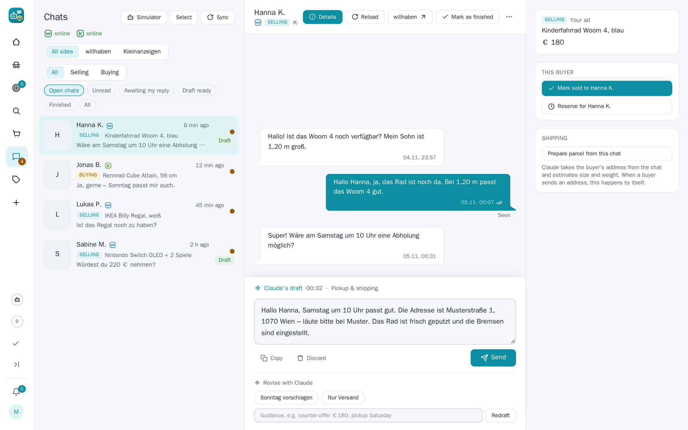

## SecondHandler 0.5.5

A release about chats that stay connected: Kleinanzeigen's chats join willhaben's and Vinted's, Vinted keeps its login
for good (and logs in again by itself when it does lose it), the VPN no longer locks itself out, and a broad audit of
the app fixed security, reliability and correctness issues all over.

### Kleinanzeigen chats

- **Kleinanzeigen's chats are in the chat list** with everything willhaben's have: Claude's drafts, sending, the
  message push, the ad card, the site filter and the site mark.
- They go through the web inbox's own interface, called from a hidden tab of the logged-in browser – the way the
  Kleinanzeigen page itself does it. The login stays in the browser alone.
- **Close to live**: Kleinanzeigen has no push on the web, so the app checks the inbox's state every 20 seconds and
  reads the chat at once when something came. During the quiet hours the checks pause; afterwards everything that
  came meanwhile is read in one go.
- **An online mark** in the chat list, like willhaben's and Vinted's: online while the checks work, "pause" in the
  quiet hours, offline (with the reason) when logged out or failing.

### Vinted stays logged in

- **One holder of the login.** Vinted renews its login token on every refresh and refuses a token that was used
  already. The app and the browser's Vinted pages used to refresh the same token, so every login ended after a few
  hours. Now the app alone holds it; every Vinted page the browser opens borrows it and hands back what it changed.
- **Automatic re-login**: when the app finds Vinted (or willhaben) logged out and login details are stored, it logs in
  again by itself – at most once an hour, switchable (`auto_login_<site>`). Only a captcha or an e-mail code still
  needs you, and you get a push for it.
- The chat reads never go through the VPN, and the logged-in session has its own pacing, apart from the searches.
- The login check no longer takes Vinted's "session refresh" page for a login, and a refused login is never handed to
  the browser again.

### The VPN no longer locks itself out

- A VPN search could start dozens of new tunnels within minutes; afterwards no server gave a handshake for an hour,
  and the failovers kept trying. Every new tunnel now passes one budget (15 in 10 minutes), and once no server
  answers at all, no new one is tried for a pause that grows – the server in use may still start again, so requests
  come back with the network.

### Reading specs out of photos

- Listings that show their specs only in a photo (a spec sheet, a settings screen) are read with OCR before the
  screening, so Claude sees the CPU, memory or model number written there.

### Improvements

- Hits, drafts and Keep/Ignore do the same from the web, the Telegram Mini App and the bot (taste, push, photos,
  Telegram message).
- The Mini App's Send keeps the take-back window, says "Send + PayLivery" when a PayLivery step goes along and asks
  first, and asks before a draft with placeholders or a scam suspicion.
- A failed action (a click while the app restarts) shows a message instead of nothing.
- A logged-out Kleinanzeigen or Vinted account is pushed and shown in the chat list; `/status` and the Mini App home
  list connection problems.
- "Check now" says when the VPN held every search instead of "nothing new".
- The weekly summary can go to Telegram.
- The timeline page is faster; the database gives freed space back at night.
- Faster screening (photos side by side), similar-ad picks by Claude kept for a day, agent checks read only the hits
  on the page.
- Browser recordings are compressed and capped at 2 GB.

### Fixes

- A finished chat's leftover draft no longer shows under "Awaiting my reply" and "Draft ready".
- The Geizhals check no longer asks about the same rejected hits on every run.
- An unreadable Vinted or Shpock page no longer marks the ad as gone for good; an empty willhaben or Kleinanzeigen
  answer is an error, not "nothing new".
- A Cancel on the order page while an auto-buy reads the ad again now stops the buy.
- willhaben's login check keeps its state on a server error; a failed Kleinanzeigen place lookup no longer searches
  all of Germany.
- A pause after a site's block survives a restart; a refusing VPN server is asked fewer times.
- A restart closes the browser cleanly and waits long enough for it.

### Security

- Wrong passwords over the API count toward the login lockout, with a cap over all addresses.
- The Claude subprocess no longer sees the app's passwords and tokens, and stops with its call.
- The dashboard can be framed only by itself and Telegram; the debug login is read-only.
- Confirmation before removing the payment card, resetting a playbook or deleting a simulation run.

### Upgrading

- **Behind a reverse proxy** set `FORWARDED_ALLOW_IPS` to the proxy's network (e.g. `172.18.0.0/16`), so the login
  lockout counts each visitor's own address instead of the proxy's.
- `compose.yaml` now gives the app 40 seconds to stop; pull it along with the image.
- The image now includes Tesseract (OCR); rebuild or pull it.
- Automatic re-login is on wherever login details are stored; turn it off with the setting `auto_login_vinted` or
  `auto_login_willhaben` = `0`.
