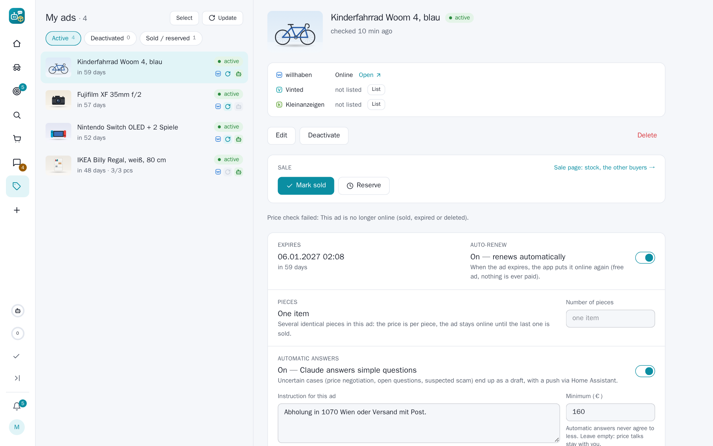

## SecondHandler 0.5.6

A release about selling on Kleinanzeigen as well and about fixing what an app-wide bug hunt found: an own willhaben ad
goes onto kleinanzeigen.de with one click or along with its publish, a pasted ad link lets you write to the seller,
Vinted's automatic login sticks, and close to thirty bugs across chats, buying, selling, search agents and Telegram are
gone.

### Own ads on Kleinanzeigen

- **A willhaben ad also on Kleinanzeigen.** My ads → the Kleinanzeigen line → **List**: title, text, photos and
  condition go through Kleinanzeigen's own ad form in the app's browser. The account must be logged in there
  (Settings → Platforms → Kleinanzeigen). Claude checks the category the site suggests and picks one from the site's
  own list when it does not fit; shipping is offered when the willhaben ad offers it.
- **Along with the publish.** The draft's publish card and the batch bar have *Also post on Kleinanzeigen* (off unless
  you switch the default on in Settings). A new ad is posted there once willhaben's review has it online.
- **A price of its own.** The comparable ads on Kleinanzeigen give a price with a note and the cost of shipping from
  Austria; the field can be changed and *Recalculate* reads the ads again. A price you did not type yourself never
  goes below the ad's minimum or 70 % of the willhaben price – then willhaben's price is posted.
- **The copy follows the ad.** Sold, reserved, expired, deleted or deactivated on willhaben reserves it on
  Kleinanzeigen; for sale again, it is activated again. Nothing is deleted there by itself: *Delete on Kleinanzeigen*
  does that, with a grace period. A renewed ad takes its copy along.
- **Never twice.** Anything unclear after the final click marks the ad *Check on Kleinanzeigen* instead of posting it
  again. This release has not posted on the live site yet: the first posting is the test, and the ad says where it
  got stuck.

### A shorter way to an online ad

- A written draft is prepared for willhaben by itself, so the publish card is ready when Claude is done.
- *Publish as soon as Claude is done* (off by default) puts the draft online by itself unless something needs you.
- The draft page and the batch bar have one clear order of buttons; the Telegram Mini App follows.

### Buying and chatting

- **A pasted ad link lets you write to the seller.** The price check of a pasted link has *Message the seller* (with
  the standard questions and *Claude writes*, e.g. an offer) or *Go to chat* when there is one.
- **Telegram's purchase button opens the buy dialog** with the dashboard's choices (way to buy, wish price, maximum,
  time, questions) when the web address is https; otherwise one tap starts with the defaults.
- **Vinted's automatic login sticks.** The login worked, but the check right after it handed the app's older session to
  the browser and undid it; the newer login now wins. A login that was sent but not seen is retried after 15 minutes.
- **An ad no longer online shows the copy the app kept** (text, photos, price, seller) with a note, not just "no
  longer online".
- A Kleinanzeigen buyer's first message is pushed; chats with more news than one sync reads are read again; removed or
  hidden Vinted and Kleinanzeigen chats come back when the other person writes; deleting a Kleinanzeigen chat no
  longer goes to willhaben; automatic answers work for Kleinanzeigen chats about own ads.

### Search agents and price checks

- **Screening without timeouts**: at most two Claude calls run at once over all agents, and a call that times out
  leaves its hits pending for the follow-up check instead of letting them through unjudged.
- The price-drop badge stays on Vinted, Kleinanzeigen, eBay and Shpock hits; a drop on a hit cleared by age brings it
  back and is reported; the push slots go to the drops that push.
- The price check's *Ask Claude*, *Compare again* and category keep the ad's site; *Recently checked* opens other
  sites' ads again.
- "Check now" and the follow-up check have a time limit; a Kleinanzeigen "VB" ad never comes back among the hits; a hit
  whose ad page says gone or sold is not pushed.

### Fixes

- An ad deactivated on willhaben is not for sale on Vinted and Kleinanzeigen either.
- A paid order never turns "failed"; an old cancelled order no longer blocks a manual Buy; auto-buy uses willhaben's own
  fee for the ad; a shipping label counts as paid only once the pay click went through.
- Telegram buttons open the ad or order they are about; the bot's ⭐ Keep says when the hit is gone; `/drafts` answers
  with its push kind switched off; "<site> needs you" is pushed once, not every hour.
- Settings → Claude: the token limit keeps "none" (0) and values over 50 M.

### Upgrading

- New database columns are added by themselves.
- Posting on Kleinanzeigen needs its account logged in in the app's browser and the platform switched on; the price
  analysis uses the Kleinanzeigen app credentials, as the search agents do.
